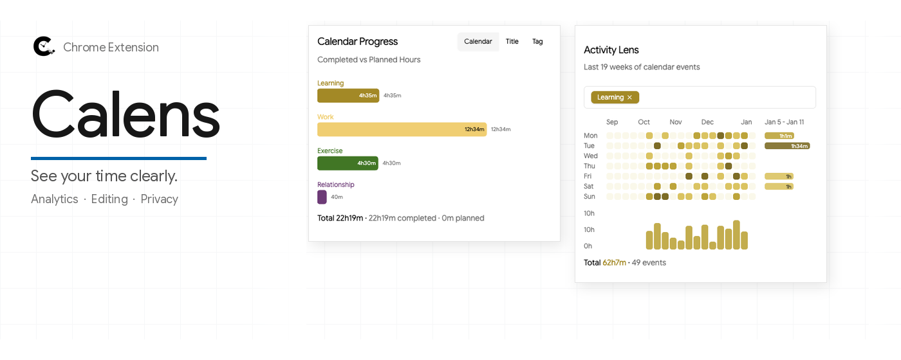

# Calens

Calens is a Chrome extension that adds time analytics and a better editing experience to Google Calendar. See where your time goes, without your calendar data leaving your browser.

[Install from the Chrome Web Store](https://chromewebstore.google.com/detail/celfolmbbepfnnmchmfojakakipnmenk)



## Features

- **Calendar Progress**: planned and completed hours per calendar, tag or title, with totals for the current view.
- **Activity Lens**: a heatmap of your scheduling patterns across recent weeks, a weekly bar chart of hours tracked, and filters by calendar, tag or event name.
- **Better event editing**: drag the top edge of an event to change its start time, and write event notes in Markdown.
- **Context-aware stats**: the numbers adapt to the calendar view you are looking at.

## Privacy

Calens reads your calendar events from Google Calendar and processes them in your browser. It does not send your events to any Calens server. The only data that leaves your browser is a Diagnostics report, and only when you choose to send one: it contains IDs and technical logs, not event content. The full privacy policy is at https://calens.dev/pages/privacy.html.

## Free and open source

Calens is free and released under the [MIT License](LICENSE). If it saves you time, you can support development through [GitHub Sponsors](https://github.com/sponsors/dvquy13). Donations are a thank-you, not a requirement.

## Development

Calens builds with Node 24 (see `.nvmrc`).

```bash
npm ci
npm run build-dev   # writes dist/
```

Then open `chrome://extensions`, enable Developer mode, click "Load unpacked" and select `dist/`. After a rebuild, click reload on the extension.

```bash
npm run typecheck   # TypeScript
npm run lint        # ESLint
npm run test        # Vitest unit tests
npm run test:e2e    # Playwright E2E tests against the real dist/ build, fully offline
```

See [CONTRIBUTING.md](CONTRIBUTING.md) for the pull request checklist. Google Calendar's DOM is undocumented, so read [docs/google-calendar-dom.md](docs/google-calendar-dom.md) before touching code that reads it.

Maintainers and coding agents can also run live checks against a signed-in Google Calendar; see `.claude/skills/verify-in-browser/SKILL.md`.

## Project layout

```
├── .claude/                 # Project rules and skills for coding agents
├── analytics/               # Metrics pipeline behind the public metrics dashboard
├── docs/                    # Development notes, troubleshooting guides, Google Calendar DOM notes
├── e2e/                     # Playwright E2E tests and Google Calendar DOM fixtures
├── functions/               # Firebase Cloud Functions (diagnostics report intake)
├── public/                  # Static assets (manifest, icons, screenshots)
├── scripts/                 # Build and utility scripts
├── store-assets/            # Chrome Web Store promo tiles and generation scripts
└── src/
    ├── background/          # Chrome extension service worker
    ├── components/          # React components
    │   ├── ui/              # Reusable UI components
    │   ├── contribution/    # Activity Lens and analytics visualizations
    │   ├── event-details/   # Event editing and display components
    │   └── sidepanel/       # Side panel specific components
    ├── content/             # Content scripts for the Google Calendar page
    ├── homepage/            # Landing page source (calens.dev)
    ├── hooks/               # Custom React hooks
    ├── lib/                 # Utilities and services
    │   ├── db/              # IndexedDB stores and schema
    │   └── sync/            # Calendar synchronization logic
    ├── privacy/             # Privacy policy page source
    ├── sidepanel/           # Main side panel React application
    └── types/               # TypeScript type definitions
```

## Docs

- The [Troubleshooting Index](./docs/troubleshoots/0-index.md) covers issues that were hard to resolve during development.
- The [Patterns and Decisions](./docs/patterns-and-decisions.md) document non-obvious choices made during development.
- The [Google Calendar DOM notes](./docs/google-calendar-dom.md) record how Google Calendar's markup behaves, as verified live.
- The [Chrome Extensions API Reference](./docs/chrome-extensions-api-ref.md) is downloaded from the Chrome Extension developer documentation.
- The [Onboarding](./docs/set-up.md) covers first-time setup.

## License

[MIT](LICENSE). Copyright (c) 2026 Quy Dinh.
